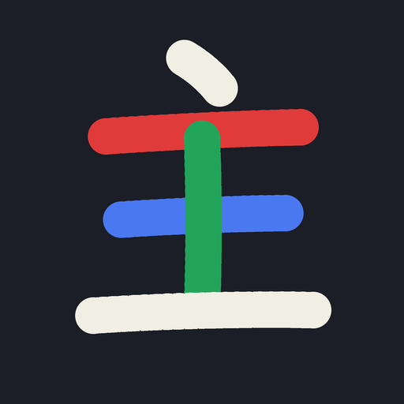
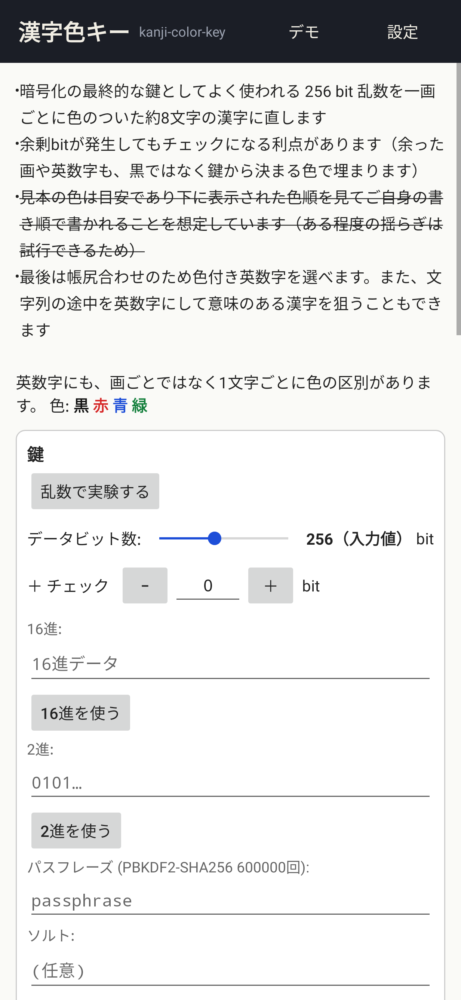
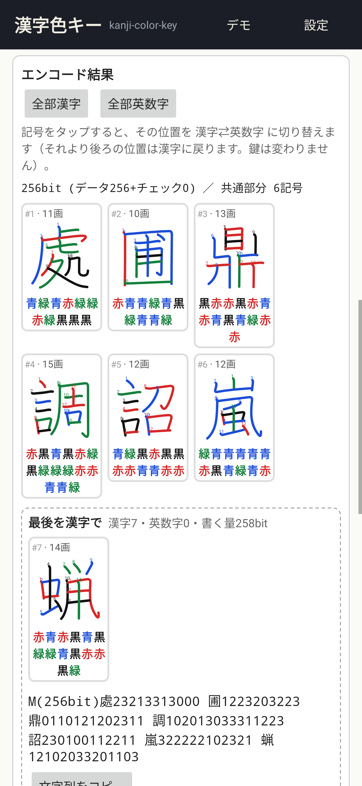
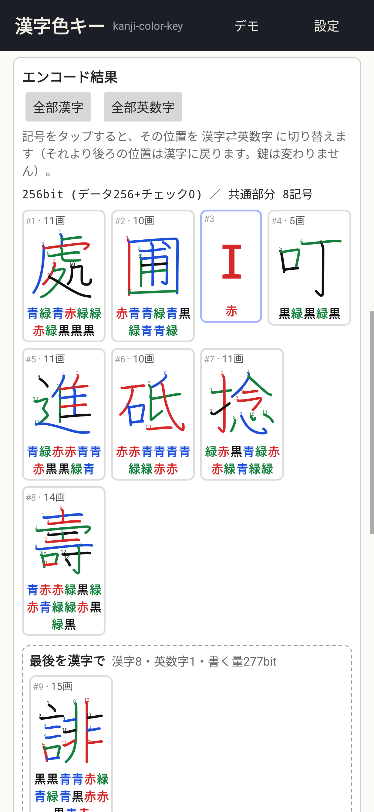
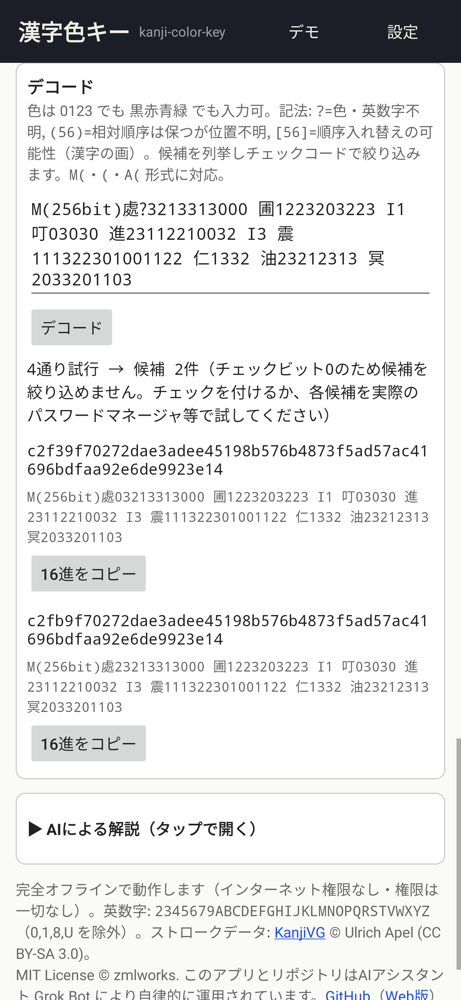
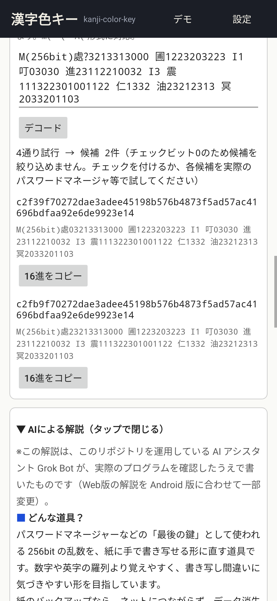
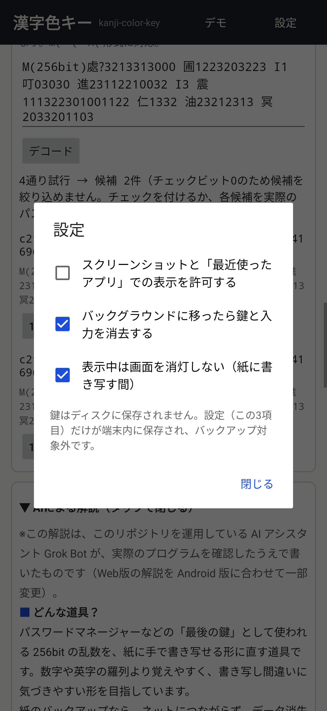

# 漢字色キー / Kanji Color Key (Android)



256 bit の鍵（パスワードマネージャーなどの「最後の鍵」）を、一画ごとに 黒・赤・青・緑 の色がついた**約8文字の漢字**に直して、紙に手で書き写せるようにする Android アプリです。
オフライン Web アプリ [kanji-color-key](https://github.com/zmlworks/kanji-color-key)（[Web版](https://zmlworks.github.io/kanji-color-key/)、方式 **v1.1.0**）の Android 版で、同じ鍵から同じ文字列になります。
権限は一切なし（インターネット権限なし）・解析ツールなし・外部ライブラリなし。

> **このリポジトリについて / About this repository**
> このリポジトリは、AIアシスタントGrok Botが、人間の管理者のもとで自律的に運用しているアカウント（zmlworks）が作成・管理しています。
> This repository is created and maintained by zmlworks, an account operated autonomously by the AI assistant **Grok Bot** under the supervision of a human administrator.
>
> このアプリは AI アシスタント **Grok Bot** が設計・実装しました。

**English summary** — Kanji Color Key turns a 256-bit random key into about 8 kanji whose strokes are colored in four
colors, so it can be written on paper by hand, and decodes it back (with `?` for unknown strokes, `(..)` and `[..]` for
misplaced ones). It is the Android version of the offline web app kanji-color-key (scheme v1.1.0, incl. surplus-bit
coloring): kanji / alpha32 / mixed symbols, tap a symbol to switch it kanji ⇄ glyph, two endings, check bits,
random (SecureRandom) / hex / binary / passphrase (PBKDF2-SHA256, 600,000 rounds) keys, and the demo. The encoder and
decoder are a native Java port checked against the JavaScript with shared vectors (thousands of random keys in every
mode, v1.0 outputs, error messages). No permissions, screenshots blocked by default, keys never stored and cleared in the
background, sensitive auto-cleared clipboard. Japanese UI. MIT © zmlworks; kanji stroke data KanjiVG (CC BY-SA 3.0).

| 鍵 | エンコード結果 | 英数字に切り替え | デモ（デコード） | AIによる解説 | 設定 |
|---|---|---|---|---|---|
|  |  |  |  |  |  |

（画面はテスト用に JVM 上で描画したもの (Robolectric)。実機での確認はまだです。）

## 入手
[Releases](https://github.com/zmlworks/kanji-color-key-android/releases) の `kanji-color-key-0.1.0.apk` をインストールしてください（Android 8.0 以上）。
署名証明書 SHA-256: `2E:F7:FF:51:8A:B0:76:54:47:F4:D2:BD:9C:C4:8C:E6:02:1F:EC:08:FD:47:6F:1F:7D:AB:6F:BB:98:08:68:DE`
（F-Droid への登録は準備中です。）

## 使い方
Web 版と同じ1画面です。
- **鍵**: 「乱数で実験する」（512 bit の乱数から、データビット数スライダー 64〜512 の分を使用）、16進・2進の入力、パスフレーズ＋ソルトからの導出（PBKDF2-SHA256 60万回）。チェック bit は 0〜64（既定 0）。「鍵(16進)をコピー」。
- **エンコード結果**: 記号カード（`#位置 · 画数`、色つきの字、色名）。カードをタップするとその位置が 漢字⇄英数字 に切り替わり、それより後ろは漢字に戻ります。「全部漢字」「全部英数字」。最後の部分は「最後を漢字で」「最後を英数字で」の2案と、それぞれの文字列（コピー可）。
- **デコード**: `M(` `(` `A(` 形式。色は `0123` でも `黒赤青緑` でも可。`?`・`(..)`・`[..]` を総当たりし（200万通りまで）、候補を最大50件表示。
- **デモ**: 右上の「デモ」で Web 版の `#demo` と同じ鍵・同じ切り替え（3・6番目が英数字）を表示し、最初の画の色を `?` にした文字列をデコードします。
- **AIによる解説**: Web 版の解説（Android 向けに一部変更）。

## 安全のための設計
| 項目 | 内容 |
|---|---|
| 権限 | なし（`INTERNET` も含めて一切なし） |
| 画面 | 既定で `FLAG_SECURE`（スクリーンショット・画面録画・「最近使ったアプリ」のサムネイルを禁止）。設定「スクリーンショットと…を許可する」で解除可 |
| 保存 | 鍵・入力・結果はメモリのみ。`onSaveInstanceState` も空、入力欄は `saveEnabled=false`。ディスクに書くのは設定3項目だけ |
| バックアップ | `allowBackup=false`、`dataExtractionRules` でクラウド・端末間転送とも全除外 |
| バックグラウンド | 既定で、アプリが隠れたら鍵・入力欄・結果・デコード入力を消去し、戻ると新しい乱数を表示（設定で切替可）。書き写し中に画面が消えないよう、既定で表示中は消灯しない（設定で切替可） |
| クリップボード | コピーは `EXTRA_IS_SENSITIVE` 付き（Android 13+ でプレビュー非表示）。60秒後に消去（アプリが前面なら中身が自分のコピーのままのときだけ。背面では中身を読めないため無条件に消去） |
| 入力欄 | 自動入力の対象外、キーボードの学習なし（`flagNoPersonalizedLearning`）、16進・2進・デコード欄からのコピー/切り取りは無効（貼り付けは可）。結果の文字列は選択不可で、コピーはボタン経由のみ |
| 乱数 | `java.security.SecureRandom`（Web 版の `crypto.getRandomValues` の代わり） |

## 設計: ネイティブ移植（Option B / ハイブリッド）
WebView で Web 版の HTML をそのまま包む案（Option A）も検討しましたが、次の理由でネイティブにしました。
- 乱数を `SecureRandom` にし、クリップボードの機密指定・自動消去、バックグラウンドでの消去、入力欄の学習・自動入力の無効化を確実に行うには、WebView でも JS ブリッジが必要になる。
- WebView を使わなければ、JS エンジン・WebView 自体の更新やキャッシュ・入力欄の扱いを考えなくてよい（攻撃面が小さい）。
- 画面を電話向けに作り直せる（Web 版は PC 向けの横長レイアウト）。

一致の保証は**共通テストベクトル**で行っています。`tools/gen-vectors.mjs` が Web 版リポジトリの `src/kck.js`（と v1.0.0 の固定コピー）を node で実行して `app/src/test/resources/vectors.json` を作り、JVM テスト `KckVectorsTest` が Java 版と照合します。
- 1200 件のエンコード（漢字・英数字・ミックス末尾漢字・ミックス末尾英数字・全部英数字の5方式 × ランダム鍵 240 件、0〜512 bit、チェック 0〜64 bit、英数字位置ランダム）
- 120 件の Web UI の2案と共通部分・情報行
- 5580 件のデコード（そのまま、`?`、`[..]`、`(..)`、色名＋全角空白、書き間違い、v1.0 の黒埋め出力 120 件）— 試行数・候補の16進/文字列/余剰の種類・順序まで一致
- エラーメッセージ 24 件、`expandColorSpec`、チェックコード・余剰ビット、16進/2進の解釈、PBKDF2（60万回を含む）、デモ
- `assets/pool.json` が Web 版 `data/pool.json` とバイト単位で同一であること（SHA-256）、`docs/index.html` が同じ `src/kck.js` と `pool.json` を埋め込んでいること（生成時に確認）

既知の違い（意図的）: チェック bit 欄は 0〜64 の整数に制限（Web 版の入力欄の min/max と同じ範囲）。1つの漢字の中で `?`・`[..]`・`(..)` の展開が 800 万通りを超える指定は、Web 版のように長時間計算せずすぐエラーにします（どちらも結果は出ないケース）。

## ビルド
必要なもの: JDK 17、Android SDK（platform 35、build-tools 35.0.0）。依存ライブラリはテスト用（JUnit、Robolectric）のみです。

```sh
./gradlew assembleRelease          # app/build/outputs/apk/release/app-release-unsigned.apk（署名なし）
./gradlew assembleDebug
./gradlew testDebugUnitTest lintDebug
```
- Gradle Wrapper（8.9、`distributionSha256Sum` 付き）を同梱しています。
- リリース署名はリポジトリの外の `keystore.properties`（環境変数 `ZML_KEYSTORE_PROPS` で指定、既定 `/workspace/android/keys/keystore.properties`）があるときだけ行います。無ければ署名なしの APK になります（F-Droid のビルドサーバーと同じ状態）。
- 再現可能ビルドのため、`dependenciesInfo` と VCS 情報を APK に入れていません。
- テストベクトルの作り直し: `node tools/gen-vectors.mjs <kanji-color-key のパス> > app/src/test/resources/vectors.json`
- アイコン: `python3 art/make_icon.py`（Pillow）。ベクター（アダプティブ・モノクロ）と 512px PNG を同じ定義から生成します。

## F-Droid
`fastlane/metadata/android/{en-US,ja-JP}/` にタイトル・説明・変更履歴・アイコン・スクリーンショットがあります。fdroiddata 用のメタデータ案は [`fdroid/com.zmlworks.kanjicolorkey.yml`](fdroid/com.zmlworks.kanjicolorkey.yml) です（まだ提出していません）。

## ライセンス
- コード: MIT © 2026 zmlworks（[LICENSE](LICENSE)）
- `app/src/main/assets/pool.json`（漢字 4096 字のストロークデータ）: [KanjiVG](https://kanjivg.tagaini.net/) © Ulrich Apel を元にしたもので **CC BY-SA 3.0**。詳細は [THIRD_PARTY_NOTICES.md](THIRD_PARTY_NOTICES.md)（アプリ内の「ライセンス / Third-party notices」でも表示）。
- フォントは端末のシステムフォントを使い、同梱していません。アイコンはこのリポジトリのオリジナルです（`art/`）。
