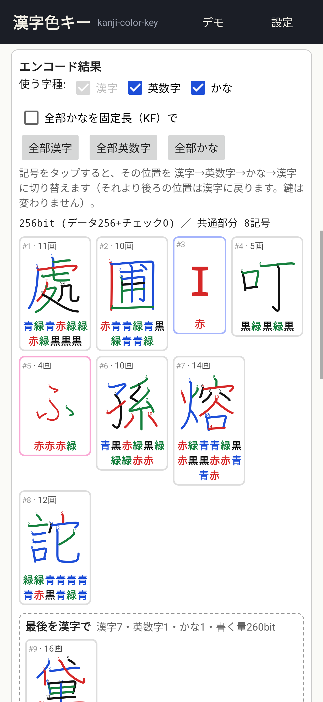
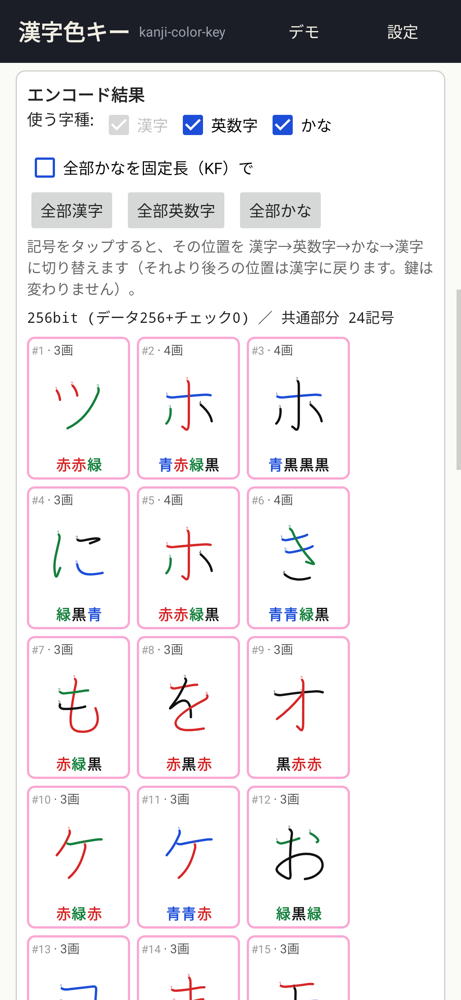
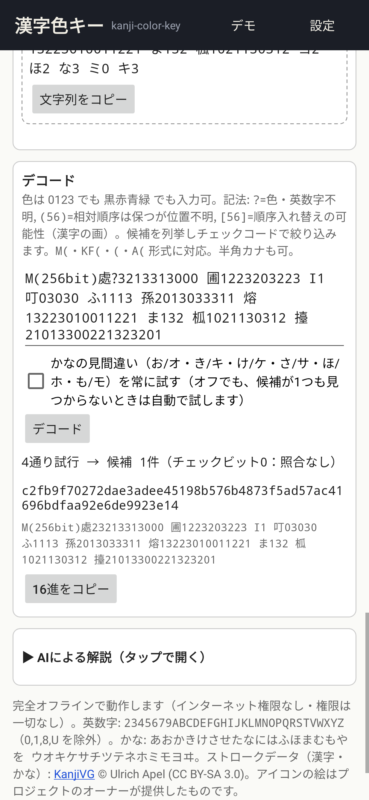
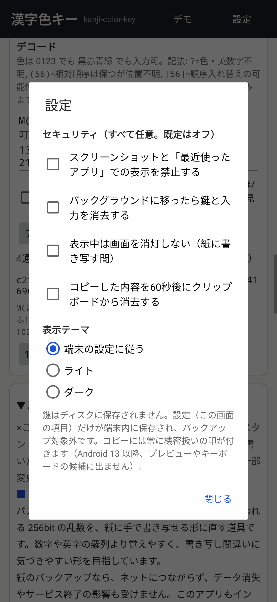
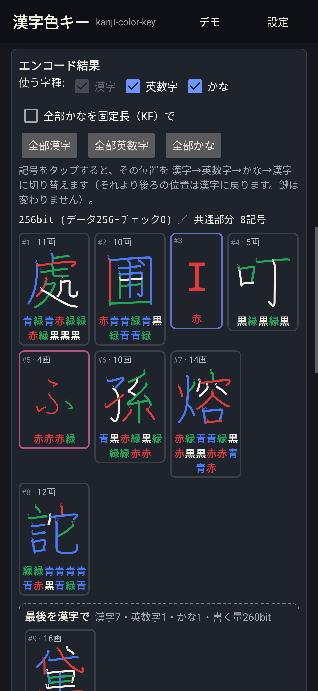

# 漢字色キー / Kanji Color Key (Android)


256 bit の鍵（パスワードマネージャーなどの「最後の鍵」）を、一画ごとに 黒・赤・青・緑 の色がついた**約8文字の漢字**（または英数字・かなとの組み合わせ）に直して、紙に手で書き写せるようにする Android アプリです。
オフライン Web アプリ [kanji-color-key](https://github.com/zmlworks/kanji-color-key)（[Web版](https://zmlworks.github.io/kanji-color-key/)、方式 **v1.2.0**）の Android 版で、同じ鍵から同じ文字列になります。
権限は一切なし（インターネット権限なし）・解析ツールなし。0.3.0 から KeePass（kotpass, MIT）を同梱。

> **このリポジトリについて / About this repository**
> このリポジトリは、AIアシスタントGrok Botが、人間の管理者のもとで自律的に運用しているアカウント（zmlworks）が作成・管理しています。
> This repository is created and maintained by zmlworks, an account operated autonomously by the AI assistant **Grok Bot** under the supervision of a human administrator.
>
> このアプリは AI アシスタント **Grok Bot** が設計・実装しました。

**English summary** — Kanji Color Key turns a 256-bit random key into about 8 kanji whose strokes are colored in four
colors, so it can be written on paper by hand, and decodes it back (with `?` for unknown strokes, `(..)` and `[..]` for
misplaced ones). It is the Android version of the offline web app kanji-color-key (scheme v1.2.0): kanji, alphanumerics
(alpha32) and, new in 0.2.0, 32 kana (5 bits + 2 bits per stroke) in any mix — tap a symbol to rotate it
kanji → alpha → kana, switch alphanumerics and kana on or off, all-kana (variable length, or the optional fixed-length
`KF(` form: 24 kana for 256 bits), three endings, a hiragana/katakana lookalike retry, check bits, random (SecureRandom) /
hex / binary / passphrase (PBKDF2-SHA256, 600,000 rounds) keys, a demo and dark mode. The encoder and decoder are a
native Java port checked against the JavaScript with shared vectors (thousands of random keys in every mode, v1.0 and
v1.1 outputs, error messages). No permissions, no storage of keys, no backup; KeePass emergency-key helper (kotpass, MIT) from 0.3.0; sensitive clipboard; screenshot blocking,
clearing in the background, keep-screen-on and clipboard auto-clear are opt-in settings. Japanese UI. MIT © zmlworks;
kanji and kana stroke data KanjiVG (CC BY-SA 3.0).

| 鍵 | 英数字・かなに切り替え | 全部かな（KF） | デモ（デコード） | 設定 | ダークモード |
|---|---|---|---|---|---|
|  |  |  |  |  |  |

（画面はテスト用に JVM 上で描画したもの (Robolectric)。実機での確認はまだです。）


## KeePass 緊急鍵（0.3.0）
右上の「KeePass」から、既存の `.kdbx` を開いてマスターパスワード（＋任意のキーファイル）を検証し、KeePass の合成鍵（256 bit・KDF 前）を漢字色キーで紙に書き残せます。同じ緊急鍵だけで後から `.kdbx` を開けます（ヘッダの KDF は実行します）。新規作成は KDBX 4・Argon2id・AES-256 または ChaCha20。Twofish の DB は読み取り専用。テスト用の `.kdbx` はリポジトリに含めません。

## 入手
[Releases](https://github.com/zmlworks/kanji-color-key-android/releases) の `kanji-color-key-0.3.0.apk` をインストールしてください（Android 8.0 以上）。
署名証明書 SHA-256: `2E:F7:FF:51:8A:B0:76:54:47:F4:D2:BD:9C:C4:8C:E6:02:1F:EC:08:FD:47:6F:1F:7D:AB:6F:BB:98:08:68:DE`
（F-Droid への登録は準備中です。）

## 使い方
Web 版と同じ1画面です。
- **鍵**: 「乱数で実験する」（512 bit の乱数から、データビット数スライダー 64〜512 の分を使用）、16進・2進の入力、パスフレーズ＋ソルトからの導出（PBKDF2-SHA256 60万回）。チェック bit は 0〜64（既定 0）。「鍵(16進)をコピー」。
- **使う字種**: 漢字は常に使用。「英数字」「かな」はそれぞれオン/オフでき、既定は両方オン。
- **エンコード結果**: 記号カード（`#位置 · 画数`、色つきの字、色名）。カードをタップするとその位置が 漢字 → 英数字 → かな → 漢字 の順に変わり（字種が1つだけオンなら2通りの切り替え）、それより後ろは漢字に戻ります。「全部漢字」「全部英数字」「全部かな」。
- **最後の部分**: 「最後を漢字で」「最後を英数字で」「最後を1色かなで」の案（同じ文字列になる案は1つにまとめます）。全部かなは既定で可変長、「全部かなを固定長（KF）で」をオンにすると `KF(` 形式（かな1字に3色＋4画目以降は黒、256 bit で24字）。
- **デコード**: `M(` `(` `A(` `KF(` 形式（`K(` は `M(` と同じ扱い）。色は `0123` でも `黒赤青緑` でも可。`?`・`(..)`・`[..]` を総当たりし（200万通りまで）、候補を最大50件表示。
- **かなの見間違い**: お/オ き/キ け/ケ さ/サ ほ/ホ も/モ。候補が1つも見つからないときだけ、自動で入れ替えた読みも試します。「かなの見間違い（…）を常に試す」をオンにすると毎回試します（既定オフ）。
- **デモ**: 右上の「デモ」で Web 版の `#demo` と同じ鍵・同じ切り替え（3番目が英数字、5・8番目がかな）を表示し、最初の画の色を `?` にした文字列をデコードします。
- **AIによる解説**: Web 版の解説（Android 向けに一部変更）。
- **表示テーマ**: 既定は端末の設定に従います。設定で「ライト」「ダーク」に固定できます。ダークでは 黒 の画を明るい色（#F1EEE4）で描きます（色の名前は 黒 のまま）。

## かなについて
- かな32字: あおかきけさせたなにはふほまむもやを ウオキケサチツテネホミモヨヰ（1字 5bit ＋ 1画 2bit）。
- 「1色かな」は字全体を1色で書く記号（7bit）で、最後の部分に使います。最初の1色かなは色を1つだけ書きます（2字目以降は `ウ222` のように画ごとに書いても読めます）。
- v1.0 / v1.1 の書き付け（漢字・英数字・ミックス）はそのまま読めます。かなを使わない設定のエンコード結果は v1.1 と同じです。

## 安全のための設計
0.2.0 から、セキュリティ関係の設定はすべてチェックボックスで、既定はすべてオフです。0.1.0 で設定を保存していた場合はその値を引き継ぎます（保存していない項目は新しい既定）。

| 項目 | 内容 |
|---|---|
| 権限 | なし（`INTERNET` も含めて一切なし） |
| 画面 | 設定「スクリーンショットと「最近使ったアプリ」での表示を禁止する」で `FLAG_SECURE`（既定オフ） |
| 保存 | 鍵・入力・結果はメモリのみ。`onSaveInstanceState` も空、入力欄は `saveEnabled=false`。ディスクに書くのは設定だけ。テーマ切り替え時の再作成では、鍵と入力をメモリ内で引き継ぎます |
| バックアップ | `allowBackup=false`、`dataExtractionRules` でクラウド・端末間転送とも全除外 |
| バックグラウンド | 設定「バックグラウンドに移ったら鍵と入力を消去する」（既定オフ）。オンなら、アプリが隠れたら鍵・入力欄・結果・デコード入力を消去し、戻ると新しい乱数を表示。設定「表示中は画面を消灯しない（紙に書き写す間）」（既定オフ） |
| クリップボード | コピーは常に `EXTRA_IS_SENSITIVE` 付き（Android 13+ でプレビュー非表示）。設定「コピーした内容を60秒後にクリップボードから消去する」（既定オフ）。オンなら、アプリが前面のときは中身が自分のコピーのままのときだけ消去、背面では中身を読めないため無条件に消去 |
| 入力欄 | 自動入力の対象外、キーボードの学習なし（`flagNoPersonalizedLearning`）、16進・2進・デコード欄からのコピー/切り取りは無効（貼り付けは可）。結果の文字列は選択不可で、コピーはボタン経由のみ |
| 乱数 | `java.security.SecureRandom`（Web 版の `crypto.getRandomValues` の代わり） |

## 設計: ネイティブ移植（Option B / ハイブリッド）
WebView で Web 版の HTML をそのまま包む案（Option A）も検討しましたが、次の理由でネイティブにしました。
- 乱数を `SecureRandom` にし、クリップボードの機密指定・自動消去、バックグラウンドでの消去、入力欄の学習・自動入力の無効化を確実に行うには、WebView でも JS ブリッジが必要になる。
- WebView を使わなければ、JS エンジン・WebView 自体の更新やキャッシュ・入力欄の扱いを考えなくてよい（攻撃面が小さい）。
- 画面を電話向けに作り直せる（Web 版は PC 向けの横長レイアウト）。

一致の保証は**共通テストベクトル**で行っています。`tools/gen-vectors.mjs` が Web 版リポジトリの `src/kck.js`（と v1.0.0・v1.1.0 の固定コピー）を node で実行して `app/src/test/resources/vectors.json` を作り、JVM テスト `KckVectorsTest` が Java 版と照合します。
- 1920 件のエンコード（漢字・英数字・ミックス各種・かな入りミックス・全部かな・固定長かな KF × ランダム鍵、0〜512 bit、チェック 0〜64 bit、英数字・かなの位置と末尾の種類をランダム）
- 240 件の Web UI の案（末尾の種類・文字列・情報行・見出し、共通部分、KF）と、120 件の字種の切り替え（タップ・オン/オフ・全部ボタン）
- 12622 件のデコード（そのまま、`?`、`[..]`、`(..)`、色名＋全角空白、半角、書き間違い、かなの見間違い（自動・常に・オフ・打ち切り）、1色かなの画ごとの書き方、`K(`、v1.0 の黒埋め出力 120 件、v1.1 の出力 120 件）— 試行数・候補の16進/文字列/余剰の種類・順序・見間違いの扱いまで一致
- エラーメッセージ 220 件、`expandColorSpec`、チェックコード・余剰ビット、16進/2進の解釈、PBKDF2（60万回を含む）、デモ
- `assets/pool.json`・`assets/kana.json` が Web 版 `data/` のものとバイト単位で同一であること（SHA-256）、`docs/index.html` が同じ `src/kck.js`・`pool.json`・`kana.json` を埋め込んでいること（生成時に確認）

既知の違い（意図的）: チェック bit 欄は 0〜64 の整数に制限（Web 版の入力欄の min/max と同じ範囲）。1つの漢字の中で `?`・`[..]`・`(..)` の展開が 800 万通りを超える指定は、Web 版のように長時間計算せずすぐエラーにします（どちらも結果は出ないケース）。

## ビルド
必要なもの: JDK 17、Android SDK（platform 35、build-tools 35.0.0）。依存ライブラリはテスト用（JUnit、Robolectric）のみです。

```sh
./gradlew assembleRelease          # app/build/outputs/apk/release/app-release-unsigned.apk（署名なし）
./gradlew assembleDebug
./gradlew testDebugUnitTest lintDebug
```
- Gradle Wrapper（8.9、`distributionSha256Sum` 付き）を同梱しています。
- リリース署名はリポジトリの外の `keystore.properties`（環境変数 `ZML_KEYSTORE_PROPS` で指定、既定 `/workspace/android/keys/keystore.properties`）があるときだけ行います。無ければ署名なしの APK になります（F-Droid のビルドサーバーと同じ状態）。
- 再現可能ビルドのため、`dependenciesInfo` と VCS 情報を APK に入れていません。
- テストベクトルの作り直し: `node tools/gen-vectors.mjs <kanji-color-key のパス> > app/src/test/resources/vectors.json`
- アイコン: `python3 art/make_icon.py [--web <kanji-color-key>/docs]`（Pillow, numpy）。`art/icon-source.png` からランチャーアイコン（mipmap・アダプティブ・モノクロ）、512px PNG、Web 版の favicon を作ります（[art/README.md](art/README.md)）。

## F-Droid
`fastlane/metadata/android/{en-US,ja-JP}/` にタイトル・説明・変更履歴・アイコン・スクリーンショットがあります。fdroiddata 用のメタデータ案は [`fdroid/com.zmlworks.kanjicolorkey.yml`](fdroid/com.zmlworks.kanjicolorkey.yml) です（まだ提出していません）。

## ライセンス
- コード: MIT © 2026 zmlworks（[LICENSE](LICENSE)）
- `app/src/main/assets/pool.json`（漢字 4096 字のストロークデータ）と `app/src/main/assets/kana.json`（かな32字のストロークデータ）: [KanjiVG](https://kanjivg.tagaini.net/) © Ulrich Apel を元にしたもので **CC BY-SA 3.0**。詳細は [THIRD_PARTY_NOTICES.md](THIRD_PARTY_NOTICES.md)（アプリ内の「ライセンス / Third-party notices」でも表示）。
- アイコン: icon artwork supplied by the project owner（アイコンの絵はプロジェクトのオーナーが提供したものです。`art/icon-source.png`）。
- フォントは端末のシステムフォントを使い、同梱していません。
